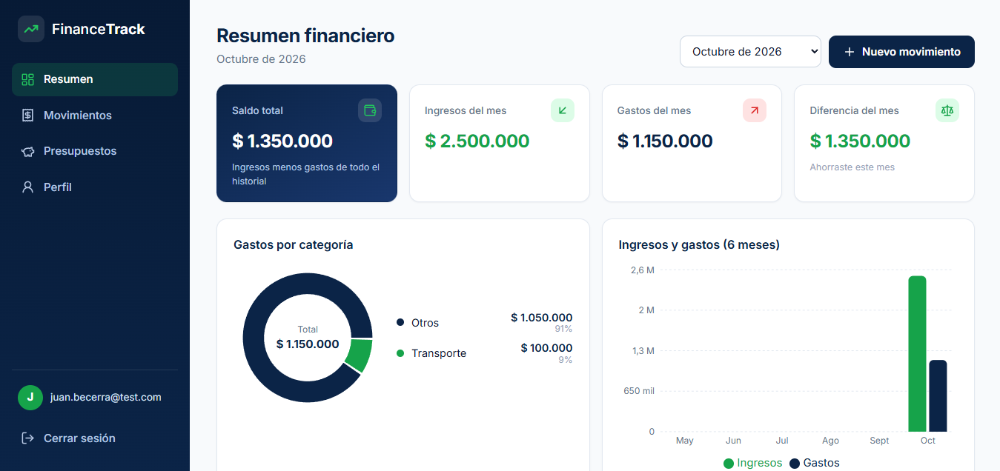
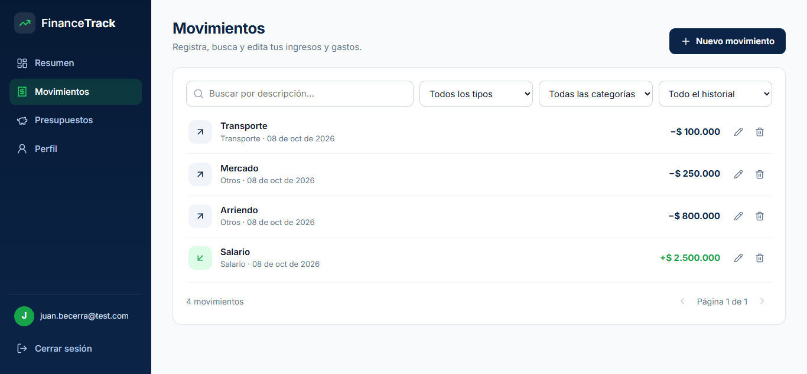
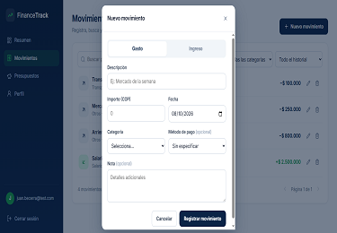
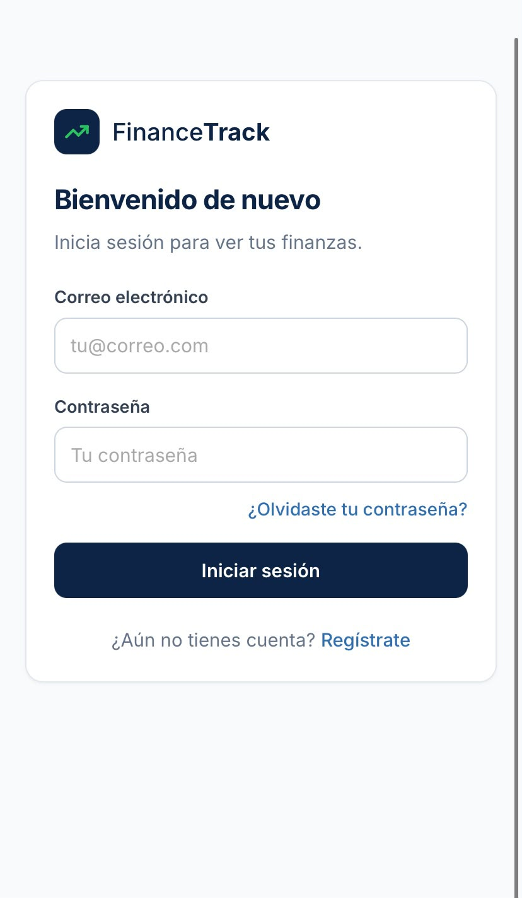
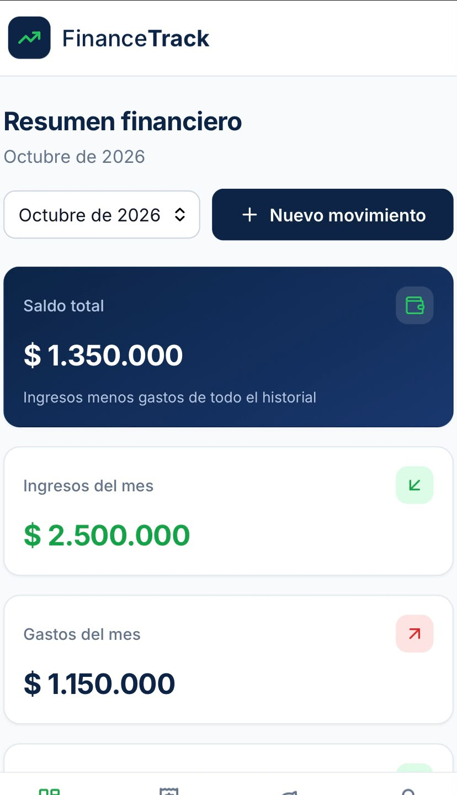

# FinanceTrack

FinanceTrack es una aplicación web de finanzas personales que desarrollé para registrar ingresos y gastos, consultar transacciones y tener una visión general de la actividad financiera desde un mismo panel.

El proyecto utiliza React y Firebase para gestionar la interfaz, la autenticación y el almacenamiento de los datos. También incluye un dashboard con información resumida de las finanzas y una interfaz adaptable a distintos dispositivos.

**Demostración:** [Ver FinanceTrack](https://financetrack-849c1.web.app/)

**Repositorio:** [GitHub](https://github.com/juanbecerrap/FinanceTrack)

## Acceso de prueba

Puedes utilizar las siguientes credenciales para iniciar sesión en la aplicación:

- **Correo:** demo@financetrack.com
- **Contraseña:** Demo2026.

## Funcionalidades

- Registro e inicio de sesión de usuarios.
- Panel principal con un resumen de la actividad financiera.
- Registro y consulta de ingresos y gastos.
- Gestión de transacciones financieras.
- Almacenamiento de los datos en Cloud Firestore.
- Autenticación mediante Firebase Authentication.
- Interfaz adaptable a computadores, tabletas y dispositivos móviles.
- Formularios para introducir y gestionar movimientos financieros.

## Capturas de pantalla

### Dashboard



### Transacciones



### Añadir transacción



### Versión móvil

<p align="center">
  
  
</p>

## Tecnologías utilizadas

| Tecnología | Uso |
|---|---|
| React | Construcción de la interfaz |
| JavaScript | Lógica e interactividad |
| CSS3 | Estilos y diseño responsive |
| Firebase Authentication | Registro e inicio de sesión |
| Cloud Firestore | Almacenamiento de datos |
| Firebase Hosting | Publicación de la aplicación |
| Vite | Desarrollo y compilación |
| React Router | Navegación entre páginas |
| Recharts | Visualización de datos mediante gráficos |
| Lucide React | Iconos de la interfaz |
| Vitest | Ejecución de pruebas |
| Git y GitHub | Control de versiones y repositorio |

## Instalación y ejecución local

### Requisitos previos

- Node.js y npm.
- Git.
- Un proyecto de Firebase con Authentication y Cloud Firestore configurados.

### 1. Clonar el repositorio

Abre CMD y ejecuta:

```cmd
git clone https://github.com/juanbecerrap/FinanceTrack.git
cd FinanceTrack
```

### 2. Instalar las dependencias

```cmd
npm install
```

### 3. Configurar Firebase

En la raíz del proyecto encontrarás el archivo `.env.example`, que contiene las variables necesarias para configurar Firebase.

Crea una copia llamada `.env`:

```cmd
copy .env.example .env
notepad .env
```

Completa las variables con los valores de tu aplicación web de Firebase. Puedes encontrarlos en la configuración del proyecto, en la sección de aplicaciones web.

El archivo debe contener estas variables:

```env
VITE_FIREBASE_API_KEY=
VITE_FIREBASE_AUTH_DOMAIN=
VITE_FIREBASE_PROJECT_ID=
VITE_FIREBASE_STORAGE_BUCKET=
VITE_FIREBASE_MESSAGING_SENDER_ID=
VITE_FIREBASE_APP_ID=
```

Guarda los cambios antes de continuar.

No subas archivos `.env` con tu configuración local al repositorio. Las reglas de seguridad de Firestore deben estar configuradas correctamente para proteger los datos de los usuarios.

### 4. Iniciar la aplicación

Ejecuta:

```cmd
npm run dev
```

Vite mostrará en la terminal la dirección local. Normalmente será:

[http://localhost:5173](http://localhost:5173)

### 5. Ejecutar las pruebas

FinanceTrack utiliza Vitest para ejecutar las pruebas configuradas en el proyecto.

```cmd
npm test
```

### 6. Generar la versión de producción

```cmd
npm run build
```

Los archivos optimizados se generan en la carpeta `dist/`.

Para comprobar la compilación localmente:

```cmd
npm run preview
```

## Firebase y almacenamiento de datos

FinanceTrack utiliza Firebase Authentication para gestionar el acceso de los usuarios y Cloud Firestore para almacenar la información financiera.

La aplicación necesita una configuración válida de Firebase para funcionar correctamente en un entorno local. También es importante mantener las reglas de seguridad de Firestore actualizadas para impedir que los usuarios accedan a datos que no les corresponden.

## Despliegue

La aplicación está publicada mediante Firebase Hosting.

**Demostración:** [https://financetrack-849c1.web.app/](https://financetrack-849c1.web.app/)

Para generar una nueva versión, ejecuta:

```cmd
npm run build
```

Después, si tienes Firebase CLI instalado, has iniciado sesión y el proyecto está configurado correctamente, puedes desplegar la aplicación con:

```cmd
firebase deploy --only hosting
```

El despliegue requiere que la configuración de Firebase Hosting apunte a la carpeta `dist/` y que las variables de entorno necesarias estén disponibles durante la compilación.

## Objetivo del proyecto

Con FinanceTrack practiqué el desarrollo de una aplicación de finanzas personales con React y Firebase. Trabajé en la gestión de transacciones, la autenticación, el almacenamiento de datos y la presentación de información financiera en un dashboard.

También reforcé la organización de componentes, el diseño responsive y el proceso de publicación de una aplicación web.

## Autor

**Juan Angel Becerra Padilla**

- [GitHub](https://github.com/juanbecerrap)
- [LinkedIn](https://www.linkedin.com/in/juanbecerrap/)